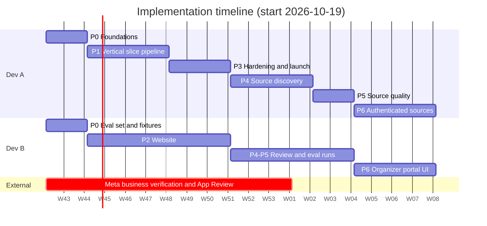

# Implementation Plan: Zagreb Events Aggregator

| Field | Value |
|---|---|
| Document type | Implementation Plan |
| Version | 1.0 |
| Date | 2026-10-16 |
| Source design | Technical Design Document v1.2 (`zagreb-events-tdd.md`) |
| Team | 2 developers, assisted by Claude Code |

---

## 1. Planning Assumptions

| ID | Assumption |
|---|---|
| A1 | Developer A (Dev A) has 20 hours per week. Developer B (Dev B) has 8 hours per week. |
| A2 | Estimates are in focused working days of 4 hours, including Claude Code assistance, testing and review. If capacity differs, scale the calendar duration and keep the phase order. |
| A3 | Dev A owns the pipeline, infrastructure and integrations. Dev B owns the frontend, the evaluation set and code review. |
| A4 | Each pull request requires review by the other developer. Infrastructure, IAM and authentication code require review regardless of size. |
| A5 | One AWS account per environment: `dev` and `prod`, in one AWS Organization. Terraform workspaces `dev` and `prod` map to these accounts. |
| A6 | Each phase ends with a deployable state. No phase depends on a later phase. |

### 1.1 Capacity

| Developer | Hours per week | Working days per week (4 h) |
|---|---|---|
| Dev A | 20 | 5.0 |
| Dev B | 8 | 2.0 |
| Total | 28 | 7.0 |

---

## 2. Delivery Strategy

The plan delivers a vertical slice first: seed sources through to a public website. Discovery, source quality management and authenticated sources follow as increments on a running system.

| Milestone | Week | Result |
|---|---|---|
| M0 Foundations | 2 | Repository, CI/CD, Terraform bootstrap, external accounts requested |
| M1 Vertical slice | 6 | Weekly pipeline publishes seed-source events to a `dev` website (list view, detail pages) |
| M2 Public launch | 9 | `prod` website with all FR-26 to FR-32 features, quality gate, monitoring |
| M3 Source discovery | 13 | Monthly pipeline with six discovery channels and source scoring |
| M4 Source quality | 15 | Probation lifecycle, source metrics, source precedence |
| M5 Authenticated sources | 19 | Organizer portal, connected Facebook Pages, partner sources |



### 2.1 Critical Path

1. **Meta App Review** (T-0.9, T-6.9) has the longest external lead time. Start business verification in week 1. Phase 6 cannot launch without approval.
2. **Bedrock model access** (T-0.6) is required before T-1.7.
3. **Evaluation set** (T-0.10) is required before the FR-20 accuracy check in T-1.7 and T-3.6.

---

## 3. Repository Structure

```
zagreb-events/
├── CLAUDE.md                     # Claude Code project instructions (Section 5.1)
├── docs/
│   ├── tdd.md                    # Technical Design Document
│   ├── implementation-plan.md    # This document
│   └── adr/                      # Architecture decision records
├── config/                       # taxonomy.yaml, seed_sources.yaml, event_path_patterns.yaml, ...
├── src/
│   ├── common/                   # pydantic models, S3/DynamoDB/SSM clients, logging, URL normalization
│   ├── discovery/                # monthly pipeline Lambda handlers
│   ├── ingestion/                # weekly pipeline Lambda handlers
│   ├── authsources/              # fetch_authenticated_source, refresh_credentials
│   ├── organizer_api/            # organizer_api handler
│   └── publish/                  # quality_gate, build_site_data, templates/
├── statemachines/                # Step Functions ASL definitions (JSON, templated)
├── containers/                   # Dockerfiles for container-image Lambdas
├── tests/
│   ├── unit/
│   ├── fixtures/                 # recorded HTML and API responses per source
│   └── eval/                     # labeled evaluation set (FR-20)
├── frontend/                     # Vite + TypeScript application
├── infra/
│   ├── bootstrap/
│   ├── data/
│   ├── pipeline/
│   ├── edge/
│   └── modules/                  # shared Terraform modules (lambda_function, ...)
└── .github/workflows/            # ci.yml, deploy.yml
```

---

## 4. Phases and Tasks

Task fields:
- **Est.** is in working days (Assumption A2).
- **TDD** lists the requirements or sections that the task implements.
- **Done when** states the acceptance condition for merging.

### Phase 0: Foundations (weeks 1–2)

| ID | Task | Owner | Est. | Depends on | TDD | Done when |
|---|---|---|---|---|---|---|
| T-0.1 | Create the repository with the structure in Section 3, `pyproject.toml` (Python 3.13, `ruff`, `mypy`, `pytest`) and `CLAUDE.md` | A | 1 | — | 3.3 | `pytest` and `ruff` run locally on an empty test suite |
| T-0.2 | Create the AWS Organization with the `dev` and `prod` accounts. Enable CloudTrail, account-level S3 Block Public Access and AWS Budgets alerts | A | 1 | — | NFR-SEC2, NFR-SEC9, 4.5 | Budgets alerts deliver a test email |
| T-0.3 | Implement the `bootstrap` Terraform stack: state bucket, GitHub OIDC provider, deployment roles per account | A | 1.5 | T-0.2 | 4.6.1, NFR-SEC6 | `terraform apply` succeeds in both accounts |
| T-0.4 | Implement `ci.yml`: lint, type check, tests, `pip-audit`, `terraform fmt` and `validate` | A | 1 | T-0.1 | 4.6.2 | CI passes on a pull request |
| T-0.5 | Register the domain in Route 53 | A | 0.5 | T-0.2 | 3.2.5 | Hosted zone resolves |
| T-0.6 | Request Amazon Bedrock access to Claude Haiku 4.5 through the EU inference profile in `eu-central-1` | A | 0.5 | T-0.2 | 3.2.3 | A test `Converse` call succeeds |
| T-0.7 | Create Brave Search API and Google Web Risk API keys. Store them in Parameter Store | A | 0.5 | T-0.2 | 3.2.8 | Keys are readable by an IAM test role |
| T-0.8 | Write `config/taxonomy.yaml`: categories, subcategories, Croatian and English terms | B | 1 | — | FR-17 | Taxonomy reviewed by both developers |
| T-0.9 | Create the Meta business portfolio and start business verification | A | 0.5 | — | NFR-C7 | Verification submitted |
| T-0.10 | Build the labeled evaluation set: 200 Zagreb events with source text, category, subcategory and the FR-11 fields | B | 3 | T-0.8 | FR-20 | `tests/eval/events.jsonl` contains 200 labeled records |
| T-0.11 | Write `config/seed_sources.yaml` with 30 seed sources (city calendar, ticketing platforms, major venues). Record an HTML fixture per seed | A | 1 | — | 2.1.1 | 30 entries with fixtures in `tests/fixtures/` |

Phase 0 total: Dev A 7.5 days, Dev B 4 days.

### Phase 1: Vertical Slice (weeks 3–6)

Scope: seed sources only, `httpx` scraping only, list view and detail pages only.

| ID | Task | Owner | Est. | Depends on | TDD | Done when |
|---|---|---|---|---|---|---|
| T-1.1 | Implement `src/common`: pydantic models for the registry entry and event records, URL normalization, structured JSON logging, S3, DynamoDB and SSM helpers | A | 2 | T-0.1 | 3.4, FR-03 | Unit test coverage ≥ 90 % for `src/common` |
| T-1.2 | Implement the `data` Terraform stack: data bucket with lifecycle rules, site bucket, `venue-cache`, `event-index`, `pipeline-state` | A | 1.5 | T-0.3 | 3.2.4 | Stack applied in `dev` |
| T-1.3 | Implement the reusable Terraform module `lambda_function` (zip and container image, IAM role, log group with 14-day retention) | A | 1.5 | T-0.3 | NFR-SEC1, 4.5 | Module used by one test function |
| T-1.4 | Implement `load_registry` and `scrape_source` (`httpx`, robots.txt, 1 request per second per source) | A | 2 | T-1.1 | FR-08, FR-09 | Tests pass against fixtures. A `dev` run stores raw events for all seeds |
| T-1.5 | Implement `clean_extract`: HTML cleaning, JSON-LD extraction, LLM extraction fallback | A | 3 | T-1.4 | FR-10 to FR-12 | Field-level extraction accuracy ≥ 85 % on the evaluation set |
| T-1.6 | Implement `deduplicate_filter` and `geocode` with the venue cache and Amazon Location Service | A | 2.5 | T-1.5 | FR-13 to FR-16 | Duplicate fixtures merge correctly. Cache hits make no Location Service call |
| T-1.7 | Implement `enrich`: tool-use JSON schema, taxonomy validation, relevance formula, `dress_code` and `food_and_drink` with `inferred` | A | 2.5 | T-1.6, T-0.6, T-0.10 | FR-17 to FR-21 | Category and subcategory accuracy ≥ 90 % on the evaluation set |
| T-1.8 | Implement `build_site_data`: index JSON, manifest, event HTML pages with Open Graph tags, sitemap | A | 2 | T-1.7 | FR-23 to FR-25, FR-32 | Generated pages pass the W3C validator and the Facebook Sharing Debugger |
| T-1.9 | Write the `event-ingestion` state machine and the `pipeline` Terraform stack with the weekly schedule | A | 2 | T-1.3 to T-1.8 | 3.2.1 | A scheduled `dev` run completes end to end |
| T-1.10 | Implement the `edge` Terraform stack: ACM, CloudFront with OAC, cache policies, response headers policy, Route 53 records | A | 1.5 | T-1.2, T-0.5 | 3.2.5 | `https://dev.<domain>` serves the site bucket |
| T-1.11 | Implement `deploy.yml`: image build, `terraform apply` per stack, frontend sync, invalidation | A | 1 | T-1.9, T-1.10 | 4.6.2 | A merge to `main` deploys to `dev` without manual steps |
| T-1.12 | Build the frontend shell: Vite and TypeScript project, data loading from the manifest, list view sorted by relevance, links to event pages | B | 4 | T-1.8 (data contract) | FR-28, FR-29 | List view renders the `dev` dataset |

Phase 1 total: Dev A 21.5 days, Dev B 4 days.

**Milestone M1:** the scheduled weekly pipeline publishes seed-source events to `https://dev.<domain>`.

### Phase 2: Website (weeks 3–9, Dev B, parallel to Phases 1 and 3)

| ID | Task | Owner | Est. | Depends on | TDD | Done when |
|---|---|---|---|---|---|---|
| T-2.1 | Implement filters: date, time of day, category, subcategory, price range. Store filter state in URL query parameters | B | 3 | T-1.12 | FR-26 | Filtering 3,000 events completes in ≤ 200 ms on a mid-range mobile device |
| T-2.2 | Implement the map view: MapLibre GL, Amazon Location Service tiles, clustering, hover and tap tooltips | B | 3 | T-1.12 | FR-27 | Markers and tooltips work on desktop and touch devices |
| T-2.3 | Implement event sharing: Web Share API, WhatsApp, Facebook and copy-link fallbacks | B | 1 | T-1.8 | FR-30 | Shared links render previews in WhatsApp and Facebook |
| T-2.4 | Implement the responsive layout from 360 px to 2560 px, Croatian and English labels | B | 2 | T-2.1, T-2.2 | FR-31, 3.2.6 | No horizontal scrolling at the tested widths |
| T-2.5 | Optimize performance: code splitting, image lazy loading, content-hashed assets | B | 1.5 | T-2.4 | NFR-P3, NFR-P5 | Lighthouse mobile LCP ≤ 2.5 s |
| T-2.6 | Write the privacy policy page and the contact page for removal requests | B | 1 | — | NFR-C4, NFR-C7 | Pages published on `dev` |

Phase 2 total: Dev B 11.5 days.

### Phase 3: Hardening and Public Launch (weeks 7–9)

| ID | Task | Owner | Est. | Depends on | TDD | Done when |
|---|---|---|---|---|---|---|
| T-3.1 | Implement `quality_gate` and the last-known-good dataset logic | A | 2 | T-1.9 | FR-22, NFR-R3 | A simulated 50 % event drop blocks publication and sends an alert |
| T-3.2 | Implement the `publish-dataset` state machine for rollback | A | 1 | T-3.1 | 4.6.3 | Rollback procedure completes in ≤ 15 minutes |
| T-3.3 | Add AWS WAF: managed rules and the rate-based rule | A | 1 | T-1.10 | 3.2.5, NFR-SEC5 | WAF blocks a load test above the rate limit |
| T-3.4 | Add CloudWatch alarms, the SNS topic, custom metrics and the `zagreb-events` dashboard | A | 2 | T-1.9 | 4.6.4 | Each alarm fires once in a test |
| T-3.5 | Add Playwright rendering to `scrape_source` for sources with `render: js`. Build the container image | A | 2 | T-1.4 | FR-08, 3.2.2 | JavaScript-rendered seed sources produce raw events |
| T-3.6 | Add incremental enrichment (unchanged events reuse the previous enriched record) | A | 1 | T-1.7 | 4.5 (cost control 5) | A second run with unchanged sources makes ≤ 10 % of the first run's Bedrock calls |
| T-3.7 | Run a security review: IAM least privilege, bucket policies, CSP, HTML escaping | B | 2 | T-3.3 | 4.4.1 | Review findings closed |
| T-3.8 | Apply all stacks to `prod`. Run 2 consecutive scheduled weekly runs in `prod` before announcing the site | A | 1 | T-3.1 to T-3.7, Phase 2 | — | Two successful `prod` runs |

Phase 3 total: Dev A 10 days, Dev B 2 days.

**Milestone M2:** public launch on `https://<domain>`.

### Phase 4: Source Discovery (weeks 10–13)

| ID | Task | Owner | Est. | Depends on | TDD | Done when |
|---|---|---|---|---|---|---|
| T-4.1 | Implement `seed_sources`, `normalize_candidates` and `update_registry` with S3 conditional writes | A | 2 | M2 | FR-02, FR-03, FR-06, FR-38 | Concurrent writes in tests produce no lost update |
| T-4.2 | Implement `enumerate_venues` with the Overpass API and `venue-cache` upserts | A | 2 | T-4.1 | 2.1.1 | Venue websites of Zagreb are collected |
| T-4.3 | Implement `mine_common_crawl`: Athena workgroup and results bucket in `us-east-1`, query, result parsing | A | 2.5 | T-4.1 | 2.1.1, NFR-C5 | One query scans ≤ 200 GB and returns candidate hosts |
| T-4.4 | Implement `search_sources` with queries generated from the taxonomy | A | 1 | T-4.1 | 2.1.1 | Results stored per run |
| T-4.5 | Implement `safety_check`: HTTPS, robots.txt, Web Risk, authentication detection, language detection | A | 2 | T-4.1 | FR-04 | Every rejection has a logged reason |
| T-4.6 | Implement `score_sources` with the features and weights in `config/source_scoring.yaml` | A | 2 | T-4.5 | FR-05, 2.1.2 | Feature values match labeled fixtures |
| T-4.7 | Implement `classify_ambiguous` | A | 1 | T-4.6 | FR-06 | Labeled ambiguous fixtures are classified with ≥ 85 % accuracy |
| T-4.8 | Write the `source-discovery` state machine and the monthly schedule | A | 1.5 | T-4.1 to T-4.7 | 3.2.1 | A `dev` run completes in ≤ 90 minutes |
| T-4.9 | Label 100 candidate pages as event source or non-event source. Calibrate the FR-05 thresholds against them | B | 2 | T-4.6 | FR-05 | Thresholds recorded in an ADR |

Phase 4 total: Dev A 14 days, Dev B 2 days.

**Milestone M3:** the monthly pipeline adds scored sources to the registry with status `probation`.

### Phase 5: Source Quality Management (weeks 14–15)

| ID | Task | Owner | Est. | Depends on | TDD | Done when |
|---|---|---|---|---|---|---|
| T-5.1 | Create the `source-metrics` table. Extend `deduplicate_filter` to emit per-source match and conflict data | A | 2 | M3 | FR-33 | Metrics stored per source and run |
| T-5.2 | Implement `compute_source_metrics`: promotion, disablement, scrape priority | A | 2 | T-5.1 | FR-34 to FR-36 | State transitions covered by unit tests for each rule |
| T-5.3 | Implement source precedence in the merge logic | A | 1 | T-5.1 | FR-37 | Conflict fixtures resolve by precedence |
| T-5.4 | Exclude probation-only events from geocoding, enrichment and publication | A | 0.5 | T-5.2 | FR-14 | Probation-only events are absent from the dataset |
| T-5.5 | Implement `expand_link_graph` using recorded outbound domains | A | 1 | T-5.1 | 2.1.1 | Candidates produced from outbound domains |
| T-5.6 | Add the discovery and source alarms | A | 0.5 | T-5.2 | 4.6.4 | Alarms fire in a test |
| T-5.7 | Review the first 4 weeks of source metrics. Adjust thresholds through an ADR | B | 1 | T-5.2 | FR-34, FR-35 | ADR merged |

Phase 5 total: Dev A 7 days, Dev B 1 day.

**Milestone M4:** sources are promoted and disabled automatically based on measured yield and accuracy.

### Phase 6: Authenticated Sources (weeks 16–19)

| ID | Task | Owner | Est. | Depends on | TDD | Done when |
|---|---|---|---|---|---|---|
| T-6.1 | Create the Meta app, configure Facebook Login for Business, the redirect URI and the callback URLs | A | 1 | T-0.9 | 4.6.3 (Set up the Meta app) | App configured in development mode |
| T-6.2 | Implement the organizer API infrastructure: API Gateway HTTP API, the `/api/*` CloudFront behavior, WAF rules, `oauth-state`, `source-authorizations` | A | 2 | M2 | 3.2.9 | `/api/*` reachable through CloudFront with throttling active |
| T-6.3 | Implement `organizer_api` connect, callback and disconnect routes | A | 3 | T-6.1, T-6.2 | FR-39, FR-40, NFR-SEC11, NFR-SEC14 | A test Page connects and disconnects in development mode |
| T-6.4 | Implement the deauthorization, data deletion and deletion status routes with `signed_request` verification | A | 1.5 | T-6.3 | FR-40, NFR-SEC12 | Invalid signatures are rejected. Deletion completes within 24 hours |
| T-6.5 | Implement `fetch_authenticated_source` for connected Pages and partner sources, with rate-limit handling | A | 2.5 | T-6.3 | FR-42, FR-44, FR-45 | Events of a test Page appear in the `dev` dataset with `extraction_method: api` |
| T-6.6 | Implement `refresh_credentials` and the Choice state in `event-ingestion` | A | 1.5 | T-6.5 | FR-43 | An invalidated token sets `auth_status: invalid` and sends an alert |
| T-6.7 | Implement organizer submissions: API route, WAF CAPTCHA, the submission channel in `normalize_candidates`, deletion of contact emails | A | 1.5 | T-6.2, M3 | FR-46 | A submission is processed in the next monthly run |
| T-6.8 | Build the organizer portal UI: connect and disconnect buttons, submission form | B | 3 | T-6.3, T-6.7 | FR-39, FR-40, FR-46 | Portal usable on desktop and mobile |
| T-6.9 | Prepare and submit Meta App Review: screencast, use-case description, privacy policy | A | 1.5 | T-6.8, T-2.6 | NFR-C7 | App Review submitted |
| T-6.10 | Security review of the OAuth flow, callbacks and secret handling | B | 1.5 | T-6.4 to T-6.6 | 4.4.1 | Review findings closed |
| T-6.11 | Onboard the first 10 connected Pages and 1 partner source in `prod` | A, B | 2 | App Review approval | FR-39, FR-41 | 10 Pages connected, 1 partner source active |

Phase 6 total: Dev A 15.5 days, Dev B 5.5 days (T-6.11 is split 1 day each).

**Milestone M5:** organizer-connected Facebook Pages and partner sources contribute events to the `prod` dataset.

### 4.1 Effort Summary

| Phase | Dev A (days) | Dev B (days) |
|---|---|---|
| P0 Foundations | 7.5 | 4 |
| P1 Vertical slice | 21.5 | 4 |
| P2 Website | — | 11.5 |
| P3 Hardening and launch | 10 | 2 |
| P4 Source discovery | 14 | 2 |
| P5 Source quality | 7 | 1 |
| P6 Authenticated sources | 15.5 | 5.5 |
| Code review | 4.5 (15 % of Dev B effort) | 7.5 (10 % of Dev A effort) |
| **Total** | **80** | **37.5** |

At the capacity in Section 1.1, Dev A needs 16 weeks and Dev B needs 19 weeks of working time. Dev B's review share is 10 % because a Claude Code first-pass review precedes each manual review (Section 5.2, step 6). If Dev B's capacity drops, move T-2.5 and T-6.8 to Dev A and extend Phase 6 by 2 weeks.

---

## 5. Claude Code Workflow

### 5.1 `CLAUDE.md` Content

Create `CLAUDE.md` in the repository root with these sections:

1. **Context:** one paragraph on the system purpose, plus a reference to `docs/tdd.md` as the authoritative design.
2. **Commands:** `make test`, `make lint`, `make typecheck`, `make fixtures`, `terraform -chdir=infra/<stack> plan`.
3. **Conventions:**
   - Python 3.13 with full type hints.
   - pydantic models from `src/common/models.py`.
   - One Lambda handler per module, with logic in pure functions.
   - No network access in unit tests; use fixtures and `moto`.
4. **Terminology:** a pointer to TDD Section 1.4. Use those terms in code identifiers.
5. **Prohibitions:**
   - Do not run `terraform apply`.
   - Do not read or print values from Parameter Store.
   - Do not modify `tests/eval/`.
   - Do not add dependencies without listing them in the pull request description.

### 5.2 Task Procedure

Apply this procedure to each task in Section 4:

1. Start Claude Code in plan mode. Provide the task ID, the TDD requirement IDs and the "Done when" condition.
2. Review the plan. Reject plans that change files outside the task scope.
3. Write or record the test fixtures first. Instruct Claude Code to write failing tests against the acceptance criteria, then the implementation.
4. Run `make test lint typecheck` locally.
5. Open one pull request per task. Reference the task ID and the TDD requirement IDs.
6. Review the pull request as the other developer. Use Claude Code for a first-pass review, then review manually.

### 5.3 Review Rules

| Change type | Required review |
|---|---|
| Terraform, IAM policies, bucket policies | Manual line-by-line review of the `terraform plan` output |
| `organizer_api`, credential handling, OAuth, `signed_request` | Manual review and the security review tasks (T-3.7, T-6.10) |
| LLM prompts and JSON schemas | Evaluation set run with accuracy reported in the pull request |
| Frontend | Visual check at 360 px and 1440 px |
| Other pipeline code | Standard review |

### 5.4 Reusable Claude Code Commands

Create these project commands in `.claude/commands/` after Phase 1. They reduce repeated prompting for recurring tasks.

| Command | Purpose |
|---|---|
| `/new-lambda <name>` | Scaffold a handler module, unit test file, Terraform module call and IAM policy stub |
| `/add-source-fixture <url>` | Record an HTML fixture and create an extraction test case |
| `/eval` | Run the evaluation set and report FR-20 accuracy |
| `/tdd-check <task-id>` | Compare the current diff with the TDD requirements of the task and list gaps |

---

## 6. Risks

| ID | Risk | Impact | Mitigation |
|---|---|---|---|
| R1 | Meta App Review is rejected or delayed | Phase 6 Facebook features are delayed | Start business verification in week 1. Submit App Review with a complete screencast. Partner sources and submissions in Phase 6 do not depend on approval. |
| R2 | Seed sources block the crawler | Lower event coverage | Respect robots.txt and rate limits. Contact the venue for a feed or partner access. Prioritize JSON-LD and iCal sources. |
| R3 | LLM accuracy on Croatian text is below 90 % | FR-20 not met | Improve prompts against the evaluation set. Apply the Custom Model Import fallback (TDD 3.2.3). |
| R4 | Dev B capacity drops | Website and reviews are delayed | Phase 2 tasks are independent. Reassign T-2.5 and T-6.8 to Dev A. |
| R5 | Single developer holds pipeline knowledge | Delivery stops during Dev A's absence | Dev B reviews all pipeline pull requests. ADRs record non-obvious decisions. |
| R6 | Generated code introduces security defects | Data exposure | Mandatory manual review for the change types in Section 5.3. `pip-audit` and `npm audit` in CI. |
| R7 | Monthly cost exceeds USD 30 | Cost priority not met | Budgets alerts at 80 % and 100 %. Incremental enrichment (T-3.6). Review Bedrock token usage on the dashboard after each run. |

---

## 7. Definition of Done

A task is done when all conditions hold:

1. The "Done when" condition in Section 4 is met.
2. Unit tests pass in CI. New pipeline code has ≥ 80 % line coverage.
3. The pull request is reviewed according to Section 5.3 and merged to `main`.
4. `deploy.yml` deploys the change to `dev` without manual steps.
5. TDD sections affected by implementation changes are updated in the same pull request.
