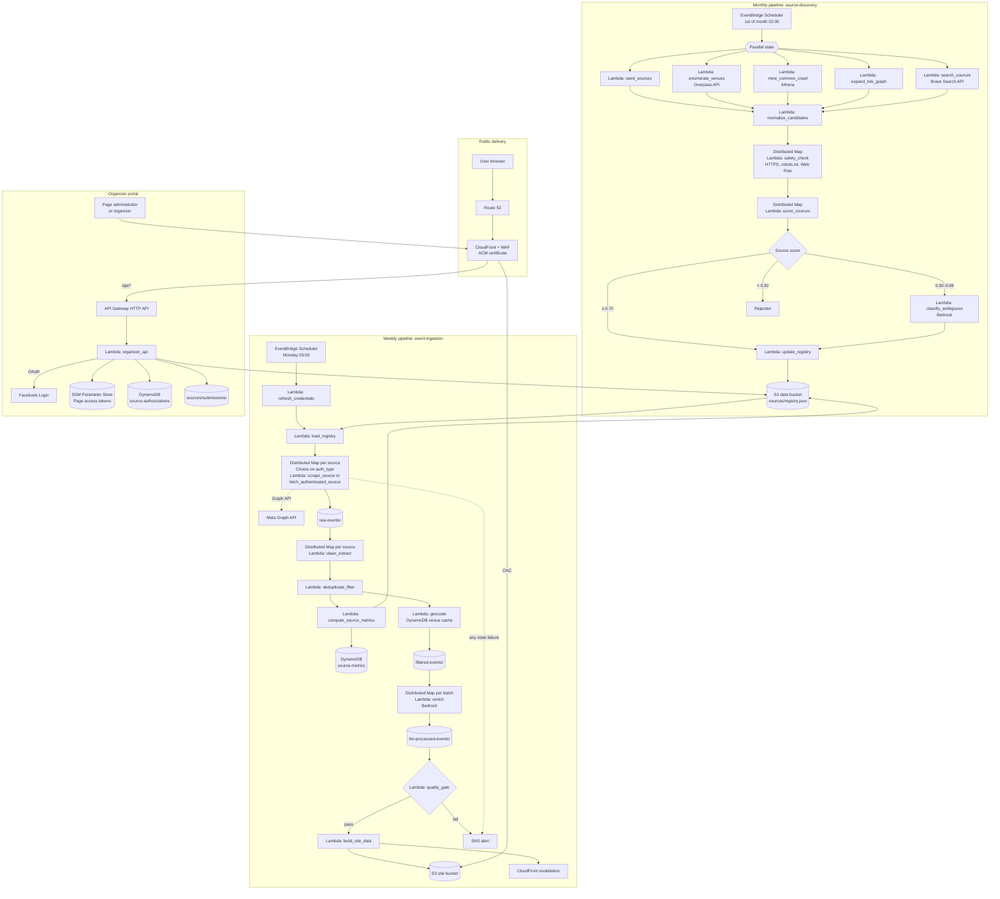

# Technical Design Document: Zagreb Events Aggregator

| Field | Value |
|---|---|
| Document type | Technical Design Document |
| Version | 1.2 |
| Date | 2026-10-16 |
| Revision 1.1 | Multi-channel source discovery, deterministic source scoring, source quality lifecycle |
| Revision 1.2 | Authenticated sources with access granted by the content owner: organizer-connected Facebook Pages, partner credentials, organizer source submission |
| Cloud platform | AWS, primary region `eu-central-1` |
| Implementation language | Python 3.13 |

---

## 1. Executive Summary

### 1.1 System Purpose

The system collects data about organized public events in Zagreb, Croatia. It normalizes and enriches the data with an LLM and publishes it on a public website. The website provides filtering, a map view, a list view, event detail pages and social sharing.

Event types in scope: music, theater, art, educational, hobby, thematic, sport, recreation, workshops and meetups.

### 1.2 Scope

**In scope:**

- Monthly multi-channel discovery, scoring and validation of web sources that publish Zagreb events.
- Weekly measurement of yield, conflict rate and unique contribution for each source, and source status changes based on these measurements.
- Weekly scraping, cleaning, extraction, deduplication, geocoding and LLM enrichment of events.
- Collection of events from authenticated sources, using access granted by the content owner: organizer-connected Facebook Pages (Meta Graph API), partner APIs and partner credentials.
- Organizer portal: Facebook Page connection, disconnection and source submission.
- Publication of event data as static JSON and static HTML.
- Public website, optimized for desktop and mobile.
- Infrastructure as Code (IaC) and CI/CD for all components.

**Out of scope:**

- User accounts, user-generated content and ticket sales.
- Authenticated access through user accounts or sessions that the content owner did not grant for this purpose, including scraping Facebook while logged in.
- Collection of personal data of event attendees and of individual hosts.
- Events outside the City of Zagreb.
- Real-time event updates. Data freshness is weekly.

### 1.3 Key Priorities

| Rank | Priority | Design consequence |
|---|---|---|
| 1 | Cost effectiveness | Serverless and pay-per-use services only. No NAT Gateway, no self-hosted GPU, no always-on compute. Target monthly cost: ≤ USD 25. |
| 2 | Internal data isolation | The data bucket and DynamoDB tables have no public endpoint. Access is granted by IAM only. |
| 3 | Public website resilience | Static website served by CloudFront with AWS WAF. No origin compute for public pages. The organizer API is isolated under `/api/*`, with throttling and a dedicated WAF rate limit. |
| 4 | Full automation | Terraform for all infrastructure. GitHub Actions for build, test and deployment. |

### 1.4 Terminology

| Term | Definition |
|---|---|
| Source | A web page or API endpoint that publishes Zagreb events. |
| Source registry | The versioned list of validated sources, stored at `s3://<data-bucket>/sources/registry.json`. |
| Candidate | A URL found by a discovery channel that is not yet in the source registry. |
| Discovery channel | One of six candidate origins: seed list, venue enumeration, structured-data mining, link-graph expansion, search API, organizer submission (Section 2.1.1). |
| Content owner | The organization that publishes the events of a source: a venue, an organizer or a ticketing platform. |
| Authenticated source | A source that is accessed with a token or credential granted by its content owner. |
| Auth type | One of `none`, `api_key`, `oauth_page_token`, `partner_credentials` (FR-41). |
| Connected Page | A Facebook Page whose administrator granted the system read access through the organizer portal (FR-39). |
| Page access token | The Meta Graph API token issued for a connected Page. |
| Organizer portal | The website section `/organizers/` and the organizer API under `/api/*` (Section 3.2.9). |
| Source status | One of `probation`, `active`, `disabled`, `blocked` (Section 2.6). |
| Source type | One of `venue`, `organizer`, `ticketing`, `other` (FR-37). |
| Source score | The weighted sum, in [0, 1], of deterministic page features (FR-05). |
| Valid event | A filtered event that passes schema validation, is located in Zagreb and is within the FR-14 time window. |
| Yield | The number of valid events that a source produces in one weekly run. |
| Matched event | A valid event of a source that was merged with a record from at least one other source (FR-13). |
| Conflict rate | Conflicting matched events divided by matched events, over the last 4 weekly runs (FR-33). |
| Unique contribution | Valid events produced only by the source, divided by yield, over the last 4 weekly runs (FR-33). |
| Monthly pipeline | The Step Functions state machine `source-discovery`. |
| Weekly pipeline | The Step Functions state machine `event-ingestion`. |
| Raw event | Scraped HTML of one source page, stored in `raw-events/`. |
| Filtered event | A cleaned, extracted, deduplicated and geocoded event record, stored in `filtered-events/`. |
| Enriched event | A filtered event extended with LLM-generated fields, stored in `llm-processed-events/`. |
| Event ID | `sha256(normalized_title + start_date + venue_id)`, truncated to 16 hex characters. |
| Dataset | The set of files published to the website for one weekly pipeline run. |
| Last-known-good dataset | The most recent dataset that passed the quality gate. |
| Data bucket | Private S3 bucket for pipeline data. |
| Site bucket | Private S3 bucket for website files, read by CloudFront through OAC. |

---

## 2. Functional Requirements

### 2.1 Source Discovery (Monthly Pipeline)

| ID | Requirement | Acceptance criteria |
|---|---|---|
| FR-01 | The monthly pipeline runs on the 1st day of each month at 02:00 `Europe/Zagreb`. | The EventBridge Scheduler schedule `cron(0 2 1 * ? *)` with timezone `Europe/Zagreb` starts one execution per month. |
| FR-02 | The system collects candidates from the six discovery channels in Section 2.1.1. | Each channel writes its candidates to `sources/candidates/run=<date>/channel=<channel>.jsonl`. The failure of one channel does not stop the monthly pipeline. |
| FR-03 | The system normalizes and deduplicates candidates. | URLs are normalized: lowercase host, no `www.`, no trailing slash, no tracking parameters (`utm_*`, `fbclid`, `gclid`). Duplicate normalized URLs are merged, and the merged candidate retains every channel that found it. Candidates whose normalized URL exists in the source registry are discarded. Exception: disabled sources re-enter as candidates 90 days after their status change. Blocked sources never re-enter. |
| FR-04 | The system applies safety filters to each candidate. | A candidate passes only if all of the following hold: (1) HTTP status is 200 over HTTPS. (2) `robots.txt` permits the crawler user agent. (3) Google Web Risk API returns no threat. (4) The page does not require authentication. (5) The detected page language is Croatian or English. A candidate that fails any condition is rejected, and the rejection reason is logged. A candidate rejected for condition (4) is logged with reason `auth_required` and is eligible for onboarding as an authenticated source under FR-39 or FR-41. |
| FR-05 | The system computes a source score for each candidate that passes FR-04, using the features in Section 2.1.2. | Source score ≥ 0.70: accepted. Source score < 0.30: rejected. Source score from 0.30 to 0.69: passed to FR-06. Seed candidates skip FR-05 and FR-06. |
| FR-06 | The LLM classifies ambiguous candidates using cleaned page content, and the system updates the source registry. | The LLM input is the cleaned page content, truncated to 6,000 characters. The LLM generates no URLs. A candidate is accepted if the label is `event_source` and the confidence is ≥ 0.80. Accepted candidates are added with status `probation`. Accepted seed candidates are added with status `active`. Each registry update creates a new S3 object version. |

#### 2.1.1 Discovery Channels

Event path patterns are defined in `config/event_path_patterns.yaml`. Example values: `/dogadjanja`, `/događanja`, `/dogadaji`, `/program`, `/kalendar`, `/najave`, `/repertoar`, `/events`, `/event`.

| Channel | Method | Assigned source type |
|---|---|---|
| Seed list | Read `config/seed_sources.yaml`. The file is maintained by pull request. Each entry declares its URL and source type. | As declared in the file |
| Venue enumeration | Query the OpenStreetMap Overpass API for objects within the City of Zagreb administrative boundary that have a `website` or `contact:website` tag and one of these tags: `amenity=theatre`, `amenity=nightclub`, `amenity=arts_centre`, `amenity=music_venue`, `amenity=cinema`, `amenity=community_centre`, `tourism=museum`, `tourism=gallery`, `leisure=sports_centre`, `leisure=stadium`. For each venue website, collect the root URL and at most 3 linked pages whose URL path matches an event path pattern. Upsert each venue into the `venue-cache` table. | `venue` |
| Structured-data mining | Run an Amazon Athena query on the Common Crawl columnar URL index, latest crawl. Select URLs with HTTP status 200, where `url_host_tld = 'hr'` or `content_languages` contains `hrv`, and whose URL path matches an event path pattern. Output the 2,000 hosts with the most matching URLs, with at most 3 URLs per host. | `ticketing` if the host is listed in `config/ticketing_hosts.yaml`, `venue` if the host matches a `venue-cache` website, otherwise `other` |
| Link-graph expansion | Read the outbound domains recorded by `scrape_source` for active sources in the last 4 weekly runs (FR-33). Select domains linked from at least 2 active sources, excluding domains in the source registry and in `config/domain_denylist.yaml`. | Same rule as structured-data mining |
| Search API | Generate queries from `config/taxonomy.yaml`. For each subcategory, apply the Croatian and English term templates `<term> Zagreb` and `<term> Zagreb program`. Retrieve at most 20 results per query from the Brave Search API. | Same rule as structured-data mining |
| Organizer submission | Read the submissions stored at `sources/submissions/` since the previous monthly run (FR-46). | As declared by the organizer in the submission |

#### 2.1.2 Source Score Features

| Feature | Value | Weight |
|---|---|---|
| `has_event_markup` | 1 if the page contains schema.org `Event` JSON-LD or microdata, otherwise 0 | 0.30 |
| `future_date_count` | `min(n / 10, 1)`, where `n` is the number of distinct dates within the next 60 days found on the page | 0.20 |
| `zagreb_match` | 1 if the page contains a postal code from `config/zagreb_postal_codes.yaml` or a venue name from the `venue-cache` table, otherwise 0 | 0.20 |
| `has_feed` | 1 if the page links an iCal, RSS or Atom feed containing dated items, otherwise 0 | 0.10 |
| `event_url_pattern` | 1 if the URL path matches an event path pattern, otherwise 0 | 0.10 |
| `recently_updated` | 1 if the sitemap `lastmod` value or the HTTP `Last-Modified` header of the page is within the last 30 days, otherwise 0 | 0.10 |

The weights are stored in `config/source_scoring.yaml`. Their sum is 1.00.

### 2.2 Event Ingestion (Weekly Pipeline)

| ID | Requirement | Acceptance criteria |
|---|---|---|
| FR-07 | The weekly pipeline runs every Monday at 03:00 `Europe/Zagreb`. | The EventBridge Scheduler schedule `cron(0 3 ? * MON *)` with timezone `Europe/Zagreb` starts one execution per week. |
| FR-08 | The system collects every source with status `active` or `probation`. FR-36 can exclude a source from a run. Sources with `auth_type: none` are collected by `scrape_source`. Authenticated sources are collected by `fetch_authenticated_source` (FR-42). | One raw event file per scraped page is stored at `raw-events/run=<date>/source=<source_id>/<page_hash>.html`. The outbound link domains of each scraped page are recorded. Failure of one source does not stop the pipeline. |
| FR-09 | The system respects crawl constraints. | Each source is limited to 1 request per second. `robots.txt` rules are applied. The `User-Agent` header identifies the crawler and a contact URL. |
| FR-10 | The system cleans raw HTML. | Scripts, styles, navigation, headers, footers and advertisements are removed. The main content text and schema.org JSON-LD blocks are retained. |
| FR-11 | The system extracts structured fields for each event. | Each filtered event contains: `title`, `start_datetime`, `end_datetime`, `venue`, `address`, `price_min`, `price_max`, `currency`, `event_type`, `organizer`, `description_summary`, `source_url`, `ticket_url`, `image_urls`. Fields without source data are `null`. |
| FR-12 | Extraction uses schema.org `Event` JSON-LD when present. The LLM extracts from cleaned text only when JSON-LD is absent or incomplete. | Events with complete JSON-LD produce no LLM extraction call. |
| FR-13 | The system deduplicates events. | Events with identical event IDs are merged. Events with a title similarity ≥ 90 (`rapidfuzz.token_set_ratio`), the same `start_date` and the same `venue_id` are merged. The merged record takes each field value according to the source precedence in FR-37. All source URLs are retained in `source_urls`. |
| FR-14 | The system filters events. | The system removes events with `start_datetime` in the past or more than 60 days in the future, events outside the City of Zagreb, and events without `title` or `start_datetime`. Valid events whose sources all have status `probation` are used for FR-33 metrics only. They are excluded from geocoding, enrichment and publication. |
| FR-15 | The system geocodes event venues. | Every published event has `lat` and `lng`. The venue cache is queried first. Amazon Location Service is called only on a cache miss. Events that cannot be geocoded are published in the list view only, with `geocoded: false`. |
| FR-16 | The system stores filtered events. | Filtered events are stored as JSON Lines at `filtered-events/run=<date>/events.jsonl`. |

### 2.3 LLM Enrichment

| ID | Requirement | Acceptance criteria |
|---|---|---|
| FR-17 | The LLM assigns `category` and `subcategory`. | Values belong to the enumerations in `config/taxonomy.yaml`. Output that fails JSON schema validation is retried once, then marked `category: other`. |
| FR-18 | The system computes `relevance` in [0, 1]. | `relevance = 0.7 × signal_score + 0.3 × llm_score`. `signal_score` is computed from: number of sources listing the event, venue capacity tier, sold-out status, festival status and, for events from connected Pages, the aggregate `attending_count` and `interested_count`. `llm_score` is the LLM estimate of public interest. |
| FR-19 | The LLM generates `dress_code` and `food_and_drink`. | Each field contains text stated or directly implied by the source. If the source contains no relevant information, the value is `null`. Each field has an `inferred` boolean. |
| FR-20 | The LLM processes Croatian-language content. | Output text fields are in Croatian. Enrichment accuracy is ≥ 90 % for `category` and `subcategory`, measured on a labeled evaluation set of 200 Zagreb events before each model change. |
| FR-21 | The system stores enriched events. | Enriched events are stored at `llm-processed-events/run=<date>/events.jsonl`. |

### 2.4 Publication

| ID | Requirement | Acceptance criteria |
|---|---|---|
| FR-22 | The system applies a quality gate before publication. | Publication is blocked if any condition holds: (1) the event count is < 60 % of the last-known-good dataset; (2) more than 5 % of records fail schema validation; (3) more than 20 % of active sources fail. When publication is blocked, the website continues to serve the last-known-good dataset and an alert is sent. |
| FR-23 | The system generates static JSON. | `data/index.<hash>.json` contains the listing fields for all events: `id`, `title`, `start_datetime`, `category`, `subcategory`, `price_min`, `price_max`, `lat`, `lng`, `venue`, `relevance`, `thumbnail_url`. The compressed size is ≤ 300 KB. `data/manifest.json` references the current index file. |
| FR-24 | The system generates one static HTML page per event. | `events/<event_id>/index.html` contains the full event data and Open Graph and Twitter Card meta tags: `og:title`, `og:description`, `og:image`, `og:url`. |
| FR-25 | The system deploys the dataset. | The dataset files are uploaded to the site bucket, and a CloudFront invalidation is created for `/data/manifest.json`, `/events/*` and `/sitemap.xml`. |

### 2.5 Public Website

| ID | Requirement | Acceptance criteria |
|---|---|---|
| FR-26 | Filtering by date, time of day, category, subcategory and price range. | Time of day buckets: morning 06:00–11:59, afternoon 12:00–17:59, evening 18:00–05:59. Filters combine with logical AND. The filter state is stored in URL query parameters. Applying a filter updates the map view and the list view in ≤ 200 ms for 3,000 events. |
| FR-27 | Map view of filtered and unfiltered events. | Every event with `geocoded: true` has a marker. Markers cluster at zoom levels ≤ 13. On desktop, hovering a marker shows a tooltip with title, date, time, venue, price and category. On touch devices, tapping a marker shows the same tooltip. |
| FR-28 | List view of filtered and unfiltered events. | Events are sorted by `relevance` descending, then by `start_datetime` ascending. Each item shows title, date, time, venue, price, category and thumbnail. |
| FR-29 | Event detail page. | Clicking a marker tooltip or a list item opens `/events/<event_id>/`. The page shows all enriched event fields, the source links and the ticket link. |
| FR-30 | Event sharing. | On devices that support the Web Share API, a share button calls `navigator.share`. On other devices, the page shows WhatsApp (`https://wa.me/?text=`) and Facebook (`https://www.facebook.com/sharer/sharer.php?u=`) links and a copy-link button. Instagram and TikTok are reached through the Web Share API. A link shared on WhatsApp or Facebook renders a preview with the event title, description and image. |
| FR-31 | Responsive layout. | The layout is usable at viewport widths from 360 px to 2560 px without horizontal scrolling. |
| FR-32 | Search engine indexing. | `sitemap.xml` lists all event pages. Each event page contains schema.org `Event` JSON-LD. |

### 2.6 Source Quality Management (Weekly Pipeline)

| ID | Requirement | Acceptance criteria |
|---|---|---|
| FR-33 | After deduplication, the system computes metrics for each scraped source. | For each source and run, the `source-metrics` table stores: scrape success, yield, matched events, conflicting matched events, unique events and outbound domains. A matched event is conflicting if the source value of `start_datetime`, `venue_id` or `price_min` differs from the value retained in the merged record. Conflict rate and unique contribution are computed over the last 4 runs in which the source was scraped. |
| FR-34 | The system promotes or disables probation sources. | After 3 runs in status `probation`, a source becomes `active` if its mean yield is ≥ 5 and its conflict rate is ≤ 10 %. Otherwise, it becomes `disabled`. If the source has 0 matched events, the conflict rate condition is not evaluated. |
| FR-35 | The system disables active sources that fail quality thresholds. | An active source becomes `disabled` if any condition holds: (1) the scrape fails in 3 consecutive runs; (2) yield is 0 in 3 consecutive runs; (3) the conflict rate is > 20 % with ≥ 10 matched events. When a seed source is disabled, an alert is sent. |
| FR-36 | The system lowers the scrape frequency of redundant sources. | An active source with source type `other` and a unique contribution of 0 % gets `scrape_priority: low`. A low-priority source is scraped only in runs with an even ISO week number. A low-priority source returns to `scrape_priority: normal` when it produces ≥ 1 unique event in a run. |
| FR-37 | The system resolves field conflicts by source precedence. | When records are merged (FR-13), each field takes the non-null value from the source with the highest precedence. Precedence by source type: `venue` > `organizer` > `ticketing` > `other`. Ties are resolved by the lowest conflict rate, then by the highest number of non-null fields. |
| FR-38 | The system writes the source registry without lost updates. | The monthly pipeline and the weekly pipeline write `sources/registry.json` with S3 conditional writes (`If-Match` with the ETag of the read object). On HTTP 412, the writer re-reads the registry, reapplies its changes and retries, with at most 3 attempts. Each status change is appended to the `status_history` of the registry entry. |

### 2.7 Authenticated Sources

| ID | Requirement | Acceptance criteria |
|---|---|---|
| FR-39 | A Facebook Page administrator connects a Page through the organizer portal. | The page `/organizers/` shows a **Connect Facebook Page** button. The button starts the Facebook Login flow with the permissions `pages_show_list` and `pages_read_engagement` and a single-use `state` value. The administrator selects the Pages to grant in the Facebook Login dialog. For each granted Page, the system stores the Page access token in Parameter Store, creates a `source-authorizations` item and adds a source registry entry with `auth_type: oauth_page_token`, `discovery_channels: [organizer_connect]` and status `active`. The source type is `venue` if the Page name or address matches a `venue-cache` item, otherwise `organizer`. |
| FR-40 | A Page administrator disconnects a Page. | Disconnection is possible through the **Disconnect Facebook Page** button on `/organizers/`, which re-authenticates the administrator with Facebook Login, and through the Facebook app settings. The Meta deauthorization callback and the Meta data deletion callback are implemented. Within 24 hours of disconnection: the Page access token is deleted from Parameter Store, the source status is set to `disabled`, `revoked_at` is set in `source-authorizations`, and the events of the Page are excluded from the next dataset. The data deletion callback returns a confirmation code and a status URL as required by Meta. |
| FR-41 | An operator onboards a partner source. | A partner source has `auth_type: api_key` or `auth_type: partner_credentials` and an `agreement_ref` that identifies the written agreement with the content owner. The credential is stored in Parameter Store before the registry entry is created (Procedure 4.6.3). A partner source without `agreement_ref` is rejected by `update_registry`. |
| FR-42 | The system collects events from authenticated sources. | `fetch_authenticated_source` collects connected Pages with the Graph API request `GET /{page-id}/events` with `time_filter=upcoming` and the field allowlist in FR-44. It collects partner sources through the endpoints declared in the registry entry. The response is stored at `raw-events/run=<date>/source=<source_id>/<item_id>.json` and mapped to the filtered event schema without an LLM call (`extraction_method: api`). |
| FR-43 | The system validates credentials before collection. | The first state of the weekly pipeline runs `refresh_credentials`. For each connected Page, the token is checked with `GET /debug_token`. For partner sources with OAuth 2.0 client credentials, the access token is refreshed. A source with an invalid or expired credential gets `auth_status: invalid` and is excluded from the run, and an alert is sent. After 4 consecutive runs with `auth_status: invalid`, the source status is set to `disabled`. A successful reconnection through FR-39 sets `auth_status: valid` and status `active`. |
| FR-44 | The system minimizes collected data from authenticated sources. | Graph API field allowlist: `id`, `name`, `description`, `start_time`, `end_time`, `event_times`, `place`, `ticket_uri`, `cover`, `is_canceled`, `attending_count`, `interested_count`. The system does not request attendee, guest, comment, post or profile data. Partner responses are filtered to the fields of the filtered event schema before storage. |
| FR-45 | The system respects Graph API rate limits. | `fetch_authenticated_source` reads the Graph API usage headers on every response. When usage reaches 80 % of a limit, requests for that app or Page pause until usage falls below 50 %. Throttling responses are retried with exponential backoff, with at most 3 attempts. |
| FR-46 | An organizer submits a source. | The form on `/organizers/` accepts a website URL or an iCal feed URL, a source type and an optional contact email. The form is protected by an AWS WAF CAPTCHA action. Each submission is stored at `sources/submissions/<date>/<submission_id>.json`. The next monthly pipeline processes submissions as candidates of the organizer submission channel (FR-02 to FR-06). The contact email is used only to report the result and is deleted after the monthly run. |

---

## 3. Architecture & Design

### 3.1 Pipeline Diagram



### 3.2 Component Breakdown

#### 3.2.1 Orchestration

| Component | Service | Configuration |
|---|---|---|
| Monthly schedule | EventBridge Scheduler | `cron(0 2 1 * ? *)`, timezone `Europe/Zagreb`, retry policy: 3 attempts, maximum event age 1 hour. |
| Weekly schedule | EventBridge Scheduler | `cron(0 3 ? * MON *)`, timezone `Europe/Zagreb`, same retry policy. |
| `source-discovery` | Step Functions Standard | Parallel state for the five collecting discovery channels. Organizer submissions are read by `normalize_candidates`. Distributed Map for `safety_check` and `score_sources`, `MaxConcurrency` 20, tolerated failure percentage 20 %. Execution timeout: 2 hours. |
| `event-ingestion` | Step Functions Standard | First state: `refresh_credentials`. Distributed Map for collection, extraction and enrichment. In the collection map, a Choice state on `auth_type` selects `scrape_source` or `fetch_authenticated_source`. Execution timeout: 3 hours. Tolerated failure percentage per Distributed Map: 20 %. |

Each Lambda task has a retry policy: 3 attempts, exponential backoff with a 2-second base interval and a backoff rate of 2.0. When the weekly pipeline starts, it reads the latest object version of the source registry. A monthly pipeline execution that is still running does not block the weekly pipeline.

#### 3.2.2 Lambda Functions

| Function | Pipeline | Runtime and packaging | Memory | Timeout | Input | Output |
|---|---|---|---|---|---|---|
| `seed_sources` | Monthly | Python 3.13, zip | 256 MB | 1 min | `config/seed_sources.yaml` | `channel=seed.jsonl` |
| `enumerate_venues` | Monthly | Python 3.13, zip | 512 MB | 15 min | Overpass API query | `channel=venue.jsonl`, `venue-cache` upserts |
| `mine_common_crawl` | Monthly | Python 3.13, zip | 256 MB | 15 min | Athena query (`us-east-1`) | `channel=common_crawl.jsonl` |
| `expand_link_graph` | Monthly | Python 3.13, zip | 256 MB | 5 min | `source-metrics` outbound domains | `channel=link_graph.jsonl` |
| `search_sources` | Monthly | Python 3.13, zip | 512 MB | 10 min | Queries generated from `config/taxonomy.yaml` | `channel=search.jsonl` |
| `normalize_candidates` | Monthly | Python 3.13, zip | 512 MB | 5 min | All channel files, organizer submissions, source registry | Deduplicated candidates |
| `safety_check` | Monthly | Python 3.13, zip | 512 MB | 5 min | One candidate | Pass or reject result with reason |
| `score_sources` | Monthly | Python 3.13, container image (`selectolax`, `trafilatura`, `extruct`) | 1024 MB | 5 min | One candidate | Source score and feature values |
| `classify_ambiguous` | Monthly | Python 3.13, zip | 512 MB | 10 min | Ambiguous candidates | Classification label and confidence |
| `update_registry` | Monthly | Python 3.13, zip | 256 MB | 2 min | Accepted candidates | `sources/registry.json` |
| `refresh_credentials` | Weekly | Python 3.13, zip | 256 MB | 5 min | Authenticated sources, Parameter Store credentials | `auth_status` per source, refreshed partner tokens |
| `load_registry` | Weekly | Python 3.13, zip | 256 MB | 1 min | Registry | List of collectable sources for the Distributed Map |
| `scrape_source` | Weekly | Python 3.13, container image (`httpx`, Playwright Chromium) | 2048 MB | 15 min | One source | `raw-events/run=<date>/source=<id>/*.html` |
| `fetch_authenticated_source` | Weekly | Python 3.13, zip | 512 MB | 10 min | One authenticated source | `raw-events/run=<date>/source=<id>/*.json`, mapped event records |
| `clean_extract` | Weekly | Python 3.13, container image (`selectolax`, `trafilatura`, `extruct`) | 1024 MB | 15 min | Raw events of one source | Extracted records (JSON Lines) |
| `deduplicate_filter` | Weekly | Python 3.13, zip (`rapidfuzz`) | 1024 MB | 10 min | All extracted records | Deduplicated, filtered records |
| `compute_source_metrics` | Weekly | Python 3.13, zip | 512 MB | 5 min | Merge results from `deduplicate_filter`, scrape results | `source-metrics` items, source status changes in `sources/registry.json` |
| `geocode` | Weekly | Python 3.13, zip | 512 MB | 10 min | Filtered records | `filtered-events/run=<date>/events.jsonl` |
| `enrich` | Weekly | Python 3.13, zip | 512 MB | 15 min | Batch of 25 filtered events | Enriched records |
| `quality_gate` | Weekly | Python 3.13, zip | 512 MB | 2 min | Enriched dataset, last-known-good metrics | Pass or fail result |
| `organizer_api` | Organizer portal | Python 3.13, zip | 256 MB | 15 s | API Gateway requests (Section 3.2.9) | Parameter Store tokens, `source-authorizations` items, registry entries, submissions |
| `build_site_data` | Weekly | Python 3.13, zip (`jinja2`) | 1024 MB | 10 min | `llm-processed-events/run=<date>/events.jsonl` | Index JSON, event HTML pages, sitemap |

`scrape_source` uses `httpx` by default. It uses Playwright Chromium only for sources with `render: js` in the source registry.

#### 3.2.3 LLM

| Use | Service | Model | Invocation |
|---|---|---|---|
| Source classification (ambiguous candidates only, source score 0.30–0.69) | Amazon Bedrock | Anthropic Claude Haiku 4.5 through an EU cross-region inference profile | On-demand `Converse` API with a tool-use JSON schema. Input: cleaned page content. |
| Event extraction (fallback) and enrichment | Amazon Bedrock | Anthropic Claude Haiku 4.5 through an EU cross-region inference profile | On-demand `Converse` API with a tool-use JSON schema. One call per event performs extraction and enrichment. |

Rationale for replacing AWS Batch with Amazon Bedrock:

1. Bedrock has no GPU capacity, container image or model weights to manage.
2. Cost is billed per token. The weekly volume is ≤ 3,000 events of ≤ 2,000 input tokens each.
3. The Claude Haiku 4.5 model processes Croatian text. The model is accepted only if it meets the FR-20 accuracy threshold on the evaluation set.

Fallback: if the evaluation set accuracy is < 90 %, import a Croatian fine-tuned open-weight model through Bedrock Custom Model Import. Re-run the FR-20 evaluation set against the imported model before switching. Model selection is a configuration value in SSM Parameter Store (`/events/llm/model_id`) and requires no code change.

Prompt constraints:

- The system prompt prohibits generating URLs, prices, dates or venues that are absent from the source text.
- The input contains cleaned text only, truncated to 6,000 characters.
- `temperature` is set to 0.

#### 3.2.4 Data Storage

| Store | Service | Content | Retention |
|---|---|---|---|
| Data bucket `sources/` | S3, versioning enabled | Source registry, candidates per channel and run | Registry: all versions retained for 365 days. Candidates: 90 days. |
| Data bucket `sources/submissions/` | S3 | Organizer submissions | 90 days. The contact email is removed after the monthly run (FR-46). |
| Data bucket `raw-events/` | S3 | Raw HTML, authenticated source responses (JSON) | 14 days |
| Data bucket `filtered-events/` | S3 | Filtered events, JSON Lines | 60 days |
| Data bucket `llm-processed-events/` | S3 | Enriched events, JSON Lines | 180 days |
| `venue-cache` | DynamoDB, on-demand | `venue_key` → `lat`, `lng`, `address`, `capacity_tier` | No expiry |
| `event-index` | DynamoDB, on-demand | `event_id` → first seen run, last seen run, source URLs | TTL: 90 days after `end_datetime` |
| `pipeline-state` | DynamoDB, on-demand | Last-known-good dataset ID and metrics | No expiry |
| `source-metrics` | DynamoDB, on-demand | Partition key `source_id`, sort key `run_id`. Scrape success, yield, matched events, conflicting matched events, unique events, outbound domains. | TTL: 180 days |
| `source-authorizations` | DynamoDB, on-demand | Partition key `source_id`. Facebook Page ID, Page name, granted permissions, `granted_at`, `revoked_at`, `auth_status`, credential parameter name. No personal data of Page administrators. | Item deleted 30 days after `revoked_at` |
| `oauth-state` | DynamoDB, on-demand | Single-use OAuth `state` values | TTL: 10 minutes |
| Athena results bucket | S3, `us-east-1` | Athena query results of the Common Crawl index query | 7 days |
| Site bucket | S3, versioning enabled | Website build, datasets | Non-current versions: 30 days |

All buckets have S3 Block Public Access enabled at the account level and the bucket level, SSE-S3 encryption and a bucket policy that denies non-TLS requests.

#### 3.2.5 Web Delivery

| Component | Service | Configuration |
|---|---|---|
| DNS | Route 53 | Public hosted zone. `A` and `AAAA` alias records point to the CloudFront distribution. |
| TLS | ACM | Certificate in `us-east-1`, DNS validation. Minimum protocol: TLSv1.2_2021. |
| CDN | CloudFront | Origin: site bucket through Origin Access Control. HTTP/2 and HTTP/3. Compression enabled. Price class: `PriceClass_100`. |
| Firewall | AWS WAF | Web ACL on CloudFront. Rules: `AWSManagedRulesCommonRuleSet`, `AWSManagedRulesAmazonIpReputationList`, and a rate-based rule of 1,000 requests per 5 minutes per IP. |
| Security headers | CloudFront response headers policy | `Strict-Transport-Security: max-age=63072000; includeSubDomains; preload`, `Content-Security-Policy` restricted to own origin and the map tile provider, `X-Content-Type-Options: nosniff`, `X-Frame-Options: DENY`, `Referrer-Policy: strict-origin-when-cross-origin`. |

Cache policy:

| Path | TTL |
|---|---|
| `/assets/*`, `/data/index.*.json` (content-hashed) | 1 year, immutable |
| `/data/manifest.json` | 300 seconds |
| `/events/*`, `/index.html`, `/sitemap.xml` | 3,600 seconds, invalidated on each publication |

#### 3.2.6 Frontend

| Component | Technology |
|---|---|
| Application | Static single-page application built with Vite and TypeScript. Event pages are pre-rendered HTML. |
| Map | MapLibre GL JS with Amazon Location Service map tiles |
| Filtering | Client-side, over `index.<hash>.json` |
| Sharing | Web Share API, with WhatsApp, Facebook and copy-link fallbacks |
| Localization | Croatian (default) and English user interface labels. Event content is in Croatian. |

#### 3.2.7 Network

The system does not use a VPC, private subnets or a NAT Gateway.

- Lambda functions run outside a VPC and reach public websites, Amazon Bedrock and AWS APIs over the AWS-managed network.
- Data isolation is enforced by IAM policies, S3 Block Public Access and DynamoDB, which has no public data-plane endpoint that accepts unauthenticated requests.

`mine_common_crawl` runs in `eu-central-1` and starts the Athena query in `us-east-1`, the region of the Common Crawl public dataset.

`organizer_api` runs outside a VPC behind API Gateway. CloudFront forwards `/api/*` to API Gateway over HTTPS.

Exception: if a source requires an allowlisted static egress IP, attach `scrape_source` for that source to a VPC with a NAT instance (fck-nat, `t4g.nano`) and an Elastic IP.

#### 3.2.8 Secrets

| Secret type | Store | Access |
|---|---|---|
| Search API key, Google Web Risk API key | SSM Parameter Store, `SecureString`, standard tier, path `/events/secrets/api/*` | The IAM role of each Lambda function grants `ssm:GetParameter` on the specific parameter ARNs it requires, and `kms:Decrypt` on the AWS-managed `aws/ssm` key. |
| Meta app secret | `SecureString`, path `/events/secrets/meta/app_secret` | Read by `organizer_api` and `refresh_credentials` only |
| Page access tokens | `SecureString`, path `/events/secrets/fb/pages/<page_id>` | Written and deleted by `organizer_api` only. Read by `fetch_authenticated_source` and `refresh_credentials` only. |
| Partner API keys and partner credentials | `SecureString`, path `/events/secrets/partners/<source_id>` | Written by operators (Procedure 4.6.3). Read by `fetch_authenticated_source` and `refresh_credentials` only. |

The system stores no login cookies and no credentials of personal user accounts. Authenticated sources are accessed only with tokens and credentials granted by the content owner (Section 2.7).

#### 3.2.9 Organizer API

| Component | Configuration |
|---|---|
| API | API Gateway HTTP API, integration `organizer_api`. Stage throttling: 10 requests per second, burst 20. |
| CloudFront behavior | Path `/api/*`, origin API Gateway, caching disabled. Query strings and the request body are forwarded. Cookies are not forwarded. |
| WAF | Rate-based rule of 100 requests per 5 minutes per IP on `/api/*`. CAPTCHA action on `POST /api/submissions`. |

| Route | Purpose |
|---|---|
| `GET /api/fb/connect?action=connect\|disconnect` | Create a single-use `state` value in `oauth-state` that records the action, and redirect to the Facebook Login dialog. |
| `GET /api/fb/callback` | Verify and delete `state`. Exchange the code for a long-lived user token and read the granted Pages. For `action=connect`, apply FR-39. For `action=disconnect`, apply FR-40 to the granted Pages. The user token is held in Lambda memory only and is not stored. |
| `POST /api/fb/deauthorize` | Meta deauthorization callback. Verify the `signed_request` HMAC-SHA256 signature with the app secret, then apply FR-40. |
| `POST /api/fb/data-deletion` | Meta data deletion callback. Verify the `signed_request` signature, apply FR-40 and return the confirmation code and status URL. |
| `GET /api/fb/deletion-status/{code}` | Return the deletion status. |
| `POST /api/submissions` | Store an organizer submission (FR-46). |

### 3.3 Tech Stack

| Layer | Technology |
|---|---|
| Language | Python 3.13 (pipeline), TypeScript (frontend) |
| HTTP client | `httpx` |
| JavaScript rendering | Playwright with Chromium |
| HTML cleaning | `selectolax`, `trafilatura` |
| Structured data extraction | `extruct` (JSON-LD, microdata) |
| Data validation | `pydantic` v2 |
| Fuzzy matching | `rapidfuzz` |
| AWS SDK | `boto3` |
| Templating | `jinja2` |
| LLM | Amazon Bedrock, Claude Haiku 4.5 |
| Web search (long-tail discovery channel) | Brave Search API |
| Authenticated source access | Meta Graph API with Facebook Login, partner APIs |
| Organizer API | Amazon API Gateway HTTP API |
| Venue enumeration | OpenStreetMap Overpass API |
| Structured-data mining | Amazon Athena on the Common Crawl columnar URL index |
| Language detection | `lingua-language-detector` |
| URL safety | Google Web Risk API |
| Geocoding and map tiles | Amazon Location Service |
| Orchestration | AWS Step Functions Standard, Amazon EventBridge Scheduler |
| Compute | AWS Lambda (arm64) |
| Storage | Amazon S3, Amazon DynamoDB |
| Delivery | Amazon CloudFront, AWS WAF, Route 53, ACM |
| Alerting | Amazon SNS, Amazon CloudWatch |
| IaC | Terraform ≥ 1.10, AWS provider ≥ 6.0 |
| CI/CD | GitHub Actions with OIDC federation to IAM |
| Testing | `pytest`, `moto`, recorded HTML fixtures per source |

### 3.4 Data Model

#### 3.4.1 Source Registry Entry

```json
{
  "source_id": "string, sha256 of normalized URL, 16 hex characters",
  "url": "string, normalized URL",
  "source_type": "venue | organizer | ticketing | other",
  "status": "probation | active | disabled | blocked",
  "status_history": [{ "status": "string", "run_id": "string", "reason": "string" }],
  "discovery_channels": ["seed | venue | common_crawl | link_graph | search | submission | organizer_connect"],
  "auth_type": "none | api_key | oauth_page_token | partner_credentials",
  "auth_status": "valid | invalid | null for auth_type none",
  "credential_parameter": "string, Parameter Store name | null",
  "facebook_page_id": "string | null",
  "agreement_ref": "string | null, required for api_key and partner_credentials",
  "source_score": "number, 0–1 | null for seed sources",
  "render": "static | js",
  "scrape_priority": "normal | low",
  "probation_runs": "integer",
  "added_run_id": "string, YYYY-MM-DD"
}
```

#### 3.4.2 Enriched Event Record

Enriched event record (`llm-processed-events/`):

```json
{
  "id": "string, 16 hex characters",
  "title": "string",
  "start_datetime": "ISO 8601 with offset, Europe/Zagreb",
  "end_datetime": "ISO 8601 with offset | null",
  "venue": "string",
  "venue_id": "string",
  "address": "string",
  "lat": "number | null",
  "lng": "number | null",
  "geocoded": "boolean",
  "price_min": "number | null",
  "price_max": "number | null",
  "currency": "EUR",
  "is_free": "boolean",
  "event_type": "string | null",
  "organizer": "string | null",
  "description_summary": "string, ≤ 500 characters",
  "source_urls": ["string"],
  "ticket_url": "string | null",
  "image_urls": ["string"],
  "category": "enum from taxonomy.yaml",
  "subcategory": "enum from taxonomy.yaml",
  "relevance": "number, 0–1",
  "dress_code": { "value": "string | null", "inferred": "boolean" },
  "food_and_drink": { "value": "string | null", "inferred": "boolean" },
  "run_id": "string, YYYY-MM-DD",
  "attending_count": "integer | null, connected Pages only",
  "interested_count": "integer | null, connected Pages only",
  "extraction_method": "jsonld | llm | api"
}
```

Images are referenced by their source URL and are not copied to the site bucket.

---

## 4. Non-Functional Requirements

### 4.1 Performance

| ID | Requirement | Target |
|---|---|---|
| NFR-P1 | Weekly pipeline duration | ≤ 2 hours for 500 sources and 3,000 events |
| NFR-P2 | Monthly pipeline duration | ≤ 90 minutes for 5,000 candidates |
| NFR-P3 | Largest Contentful Paint, mobile, 4G connection | ≤ 2.5 seconds at p75 |
| NFR-P4 | Filter application latency | ≤ 200 ms for 3,000 events on a mid-range mobile device |
| NFR-P5 | `index.<hash>.json` size | ≤ 300 KB compressed |
| NFR-P6 | CloudFront cache hit ratio | ≥ 95 % |

### 4.2 Scalability

| ID | Requirement | Target |
|---|---|---|
| NFR-S1 | Source registry capacity | 1,000 sources without architecture change |
| NFR-S2 | Event volume | 10,000 events per weekly run without architecture change |
| NFR-S3 | Website traffic | Traffic spikes are absorbed by the CloudFront cache. The origin receives only cache misses. |
| NFR-S4 | Scraping concurrency | Distributed Map `MaxConcurrency`: 20 |
| NFR-S5 | Bedrock concurrency | Distributed Map `MaxConcurrency` for `enrich`: 5, set below the account Bedrock quota for the model |

If the event count exceeds 10,000, split `index.<hash>.json` into one file per calendar week.

### 4.3 Reliability and Availability

| ID | Requirement | Target |
|---|---|---|
| NFR-R1 | Website availability | ≥ 99.9 % monthly, inherited from the CloudFront and S3 service level agreements |
| NFR-R2 | Pipeline fault isolation | The failure of one source does not stop the weekly pipeline (tolerated failure percentage: 20 %). |
| NFR-R3 | Data integrity | The website serves only datasets that passed the quality gate (FR-22). |
| NFR-R4 | Recovery point | The last-known-good dataset and the source registry are recoverable from S3 object versions. |
| NFR-R5 | Recovery time | A dataset rollback completes in ≤ 15 minutes (Procedure 4.6.3). |
| NFR-R6 | Retries | Every Lambda task: 3 attempts with exponential backoff. Every Bedrock call: 3 attempts with backoff on throttling errors. |

### 4.4 Security and Compliance

#### 4.4.1 Security Controls

| ID | Control |
|---|---|
| NFR-SEC1 | Each Lambda function has a dedicated IAM role with least-privilege permissions scoped to specific bucket prefixes, table ARNs, parameter ARNs and model ARNs. |
| NFR-SEC2 | S3 Block Public Access is enabled at the account level and the bucket level. Bucket policies deny requests without `aws:SecureTransport`. |
| NFR-SEC3 | The site bucket policy allows `s3:GetObject` only to the CloudFront distribution through OAC (`AWS:SourceArn` condition). |
| NFR-SEC4 | DynamoDB tables are accessible only through IAM-authenticated requests from pipeline roles. |
| NFR-SEC5 | AWS WAF protects the CloudFront distribution (Section 3.2.5). AWS Shield Standard is active. |
| NFR-SEC6 | CI/CD authenticates to AWS through GitHub OIDC. No long-lived IAM access keys exist. The deployment role trust policy is restricted to the repository and the `main` branch. |
| NFR-SEC7 | Secrets are stored only in SSM Parameter Store `SecureString`. Secrets are never written to logs, environment variables or the repository. |
| NFR-SEC8 | All text that the website renders is HTML-escaped at build time. Scraped HTML is never rendered on the website. |
| NFR-SEC9 | AWS CloudTrail is enabled for management events in all regions. |
| NFR-SEC10 | Dependencies are scanned on every pull request with `pip-audit` and `npm audit`. Container images are scanned by Amazon ECR basic scanning. |
| NFR-SEC11 | The OAuth flow uses a single-use `state` value with a 10-minute TTL. The redirect URI is registered as an exact match in the Meta app. |
| NFR-SEC12 | Meta callbacks are accepted only with a valid `signed_request` HMAC-SHA256 signature. |
| NFR-SEC13 | Credentials of authenticated sources exist only in Parameter Store and in Lambda memory during execution. They are never written to S3, DynamoDB, logs or Step Functions state. Step Functions state carries the parameter name only. |
| NFR-SEC14 | Only `organizer_api` has `ssm:PutParameter` and `ssm:DeleteParameter`, scoped to `/events/secrets/fb/pages/*`. |

#### 4.4.2 Compliance

| ID | Requirement |
|---|---|
| NFR-C1 | GDPR: the system stores no personal data of website visitors and no personal data of Page administrators. Organizer data is limited to organization names published by the source. An organizer submission contact email is stored until the next monthly run only. Analytics, if added, are cookieless. |
| NFR-C2 | Crawling: the crawler obeys `robots.txt`, identifies itself in the `User-Agent` header and limits each source to 1 request per second. Authenticated sources are accessed only with access granted by the content owner. |
| NFR-C3 | Copyright: the website publishes LLM-generated summaries, not source text. Images are referenced by source URL with a visible link to the source. |
| NFR-C4 | Removal requests: the website publishes a contact address. A source removed on request is set to `status: blocked` in the source registry within 7 days. |
| NFR-C5 | Data residency: all data is stored in `eu-central-1`. LLM inference uses an EU cross-region inference profile. Exception: Athena query results derived from the public Common Crawl dataset are stored in `us-east-1` for 7 days. |
| NFR-C6 | Overpass API usage: the monthly pipeline sends 1 Overpass query per run and identifies the crawler in the `User-Agent` header. |
| NFR-C7 | Meta Platform Terms: the Meta app passes App Review for the permissions in FR-39, publishes a privacy policy URL, implements the deauthorization and data deletion callbacks (FR-40), and uses Page data only to display the public events of the connected Page. |
| NFR-C8 | Data minimization for authenticated sources follows FR-44. |
| NFR-C9 | Every partner source has a written agreement with the content owner, referenced by `agreement_ref` (FR-41). |

### 4.5 Cost

Estimated monthly cost at 500 sources and 3,000 events per week. Values are estimates; verify them in the AWS Pricing Calculator.

| Item | Estimated monthly cost (USD) |
|---|---|
| AWS Lambda | 1.00 |
| AWS Step Functions Standard (Distributed Map state transitions) | 1.00 |
| Amazon S3 (both buckets, requests and storage) | 1.00 |
| Amazon DynamoDB on-demand | 0.50 |
| Amazon Bedrock, Claude Haiku 4.5 (weekly enrichment and monthly classification of ambiguous candidates) | 7.00 |
| Amazon Athena (monthly Common Crawl index query) | 1.00 |
| OpenStreetMap Overpass API | 0.00 |
| Amazon Location Service (geocoding cache misses and map tiles) | 2.00 |
| Brave Search API | 0.00 (free tier) |
| Google Web Risk API | 0.00 (free tier) |
| Amazon CloudFront | 1.00 |
| AWS WAF (1 web ACL, 3 rules) | 8.00 |
| Route 53 (1 hosted zone, queries) | 1.00 |
| Amazon API Gateway HTTP API (organizer API) | 0.10 |
| Meta Graph API | 0.00 |
| ACM | 0.00 |
| Amazon CloudWatch Logs (14-day retention) | 1.00 |
| Amazon ECR | 0.50 |
| **Total** | **25.10** |

Cost controls:

1. An AWS Budgets alert notifies the operations email at 80 % and 100 % of USD 30 per month.
2. CloudWatch Logs retention: 14 days for all log groups.
3. S3 lifecycle rules apply the retention periods in Section 3.2.4.
4. The NAT Gateway, VPC interface endpoints and AWS Batch GPU compute are excluded from the design.
5. The enrichment step processes only events whose event ID is absent from the previous run, or whose source content hash has changed. Unchanged events reuse the previous enriched record.

### 4.6 Operational

#### 4.6.1 Infrastructure as Code

Terraform root modules, each with a separate state file:

| Stack | Path | Resources | Depends on |
|---|---|---|---|
| `bootstrap` | `infra/bootstrap` | State bucket, GitHub OIDC provider, deployment IAM role | — |
| `data` | `infra/data` | Data bucket, site bucket, DynamoDB tables, SSM parameter definitions, Athena workgroup and Athena results bucket in `us-east-1` (AWS provider alias) | `bootstrap` |
| `pipeline` | `infra/pipeline` | ECR repositories, Lambda functions, IAM roles, Step Functions state machines, EventBridge Scheduler schedules, API Gateway HTTP API, SNS topic, CloudWatch alarms | `data` |
| `edge` | `infra/edge` | ACM certificate, CloudFront distribution including the `/api/*` behavior, OAC, WAF web ACL including the organizer API rules, response headers policy, Route 53 records | `data`, `pipeline` |

Backend configuration:

- Backend: S3 with `use_lockfile = true`. No DynamoDB lock table.
- Cross-stack references: `terraform_remote_state` data sources, read-only.
- Environments: Terraform workspaces `dev` and `prod` within each stack, with variables in `env/<workspace>.tfvars`.

#### 4.6.2 CI/CD

| Trigger | Workflow | Steps |
|---|---|---|
| Pull request | `ci.yml` | 1. `ruff` and `mypy`. 2. `pytest` with `moto` and HTML fixtures. 3. `pip-audit`, `npm audit`. 4. Frontend build. 5. `terraform fmt -check`, `terraform validate`, `terraform plan` for each changed stack. Post the plan as a pull request comment. |
| Merge to `main` | `deploy.yml` | 1. Build and push container images to ECR with the commit SHA as tag. 2. `terraform apply` for changed stacks in dependency order, `dev` first, then `prod` after a GitHub Environment approval. 3. Build the frontend shell and sync it to the site bucket. 4. Invalidate `/index.html`. |
| Weekly pipeline success | Pipeline-managed | `build_site_data` publishes the dataset (FR-25). No CI/CD run is required. |

#### 4.6.3 Procedures

**Run the weekly pipeline manually**

1. Open the Step Functions console in `eu-central-1`.
2. Select the state machine `event-ingestion-prod`.
3. Choose **Start execution**. Use the input `{"run_id": "<YYYY-MM-DD>"}`.
4. Confirm that the execution status is `Succeeded`.

**Roll back the published dataset**

1. Read `last_known_good_run_id` and `previous_good_run_id` from the `pipeline-state` table.
2. Start the state machine `publish-dataset-prod` with the input `{"run_id": "<previous_good_run_id>"}`.
3. Confirm that `/data/manifest.json` on the public domain references the index file of the selected run.

**Block a source**

1. Open `sources/registry.json` in the data bucket.
2. Set `status` to `blocked` for the source. Append an entry to `status_history` with the reason.
3. Upload the file. S3 versioning retains the previous registry version.

**Add a seed source**

1. Add an entry with `url` and `source_type` to `config/seed_sources.yaml`.
2. Open a pull request and merge it after review.
3. The next monthly pipeline run adds the source with status `active` if it passes FR-04.

**Re-enable a disabled source**

1. Open `sources/registry.json` in the data bucket.
2. Set `status` to `probation` and `probation_runs` to `0` for the source. Append an entry to `status_history` with the reason.
3. Upload the file. The source is evaluated again under FR-34.

**Set up the Meta app (one-time)**

1. Create a Meta app of type **Business** in the Meta for Developers dashboard, owned by a verified Meta business portfolio.
2. Add the **Facebook Login for Business** product. Register `https://<domain>/api/fb/callback` as the only valid OAuth redirect URI.
3. Set the deauthorization callback URL to `https://<domain>/api/fb/deauthorize` and the data deletion request URL to `https://<domain>/api/fb/data-deletion`.
4. Set the privacy policy URL to `https://<domain>/privacy/`.
5. Store the app secret in Parameter Store at `/events/secrets/meta/app_secret`.
6. Submit App Review for Advanced Access to `pages_show_list` and `pages_read_engagement`.
7. Enable the **Connect Facebook Page** button on `/organizers/` after App Review approval.

**Onboard a partner source**

1. Confirm that a written agreement with the content owner exists and record its reference.
2. Store the credential in Parameter Store at `/events/secrets/partners/<source_id>` as `SecureString`.
3. Add the registry entry with `auth_type`, `credential_parameter`, `agreement_ref` and status `probation`.
4. Run the weekly pipeline manually and confirm that `fetch_authenticated_source` succeeds for the source.

**Handle an invalid Page access token alert**

1. Read the source in `source-authorizations` and confirm `auth_status: invalid`.
2. Contact the Page through its public contact channel and request reconnection on `/organizers/`.
3. Confirm after reconnection that `auth_status` is `valid`. Without reconnection, FR-43 disables the source after 4 weekly runs.

**Respond to a quality gate failure alert**

1. Open the failed `event-ingestion-prod` execution in the Step Functions console.
2. Read the `quality_gate` output to identify the failed condition.
3. For a source failure condition, inspect the `scrape_source` CloudWatch Logs for the failed source IDs. Correct the parser, or block the source.
4. Re-run the weekly pipeline manually.

#### 4.6.4 Monitoring and Alerting

| Alarm | Metric | Threshold | Action |
|---|---|---|---|
| Pipeline failure | Step Functions `ExecutionsFailed`, `ExecutionsTimedOut` | ≥ 1 | SNS email to operations |
| Quality gate failure | Custom metric `QualityGateFailed` | ≥ 1 | SNS email to operations |
| Source failure rate | Custom metric `SourceFailureRatio` | > 0.2 | SNS email to operations |
| Discovery channel failure | Custom metric `DiscoveryChannelFailed` | ≥ 1 per monthly run | SNS email to operations |
| Active source decrease | Custom metric `ActiveSourceCount` | Decrease > 20 % within 4 weekly runs | SNS email to operations |
| Seed source disabled | Custom metric `SeedSourceDisabled` | ≥ 1 | SNS email to operations |
| Invalid credential | Custom metric `AuthSourceInvalid` | ≥ 1 per weekly run | SNS email to operations |
| Graph API usage | Custom metric `GraphApiUsagePercent` | ≥ 80 % | SNS email to operations |
| Organizer API errors | API Gateway `5xx` | ≥ 5 in 15 minutes | SNS email to operations |
| Meta deauthorization | Custom metric `PageDisconnected` | ≥ 1 | SNS email to operations |
| Bedrock throttling | `InvocationThrottles` | > 50 per run | SNS email to operations |
| Lambda errors | `Errors` per function | > 5 per run | SNS email to operations |
| Website errors | CloudFront `5xxErrorRate` | > 1 % over 15 minutes | SNS email to operations |
| Cost | AWS Budgets | 80 % and 100 % of USD 30 | Email to operations |

All Lambda functions emit structured JSON logs with `run_id`, `source_id` and `event_id`. A CloudWatch dashboard `zagreb-events` displays event count, source success ratio, Bedrock token usage, pipeline duration and CloudFront request count per run.
